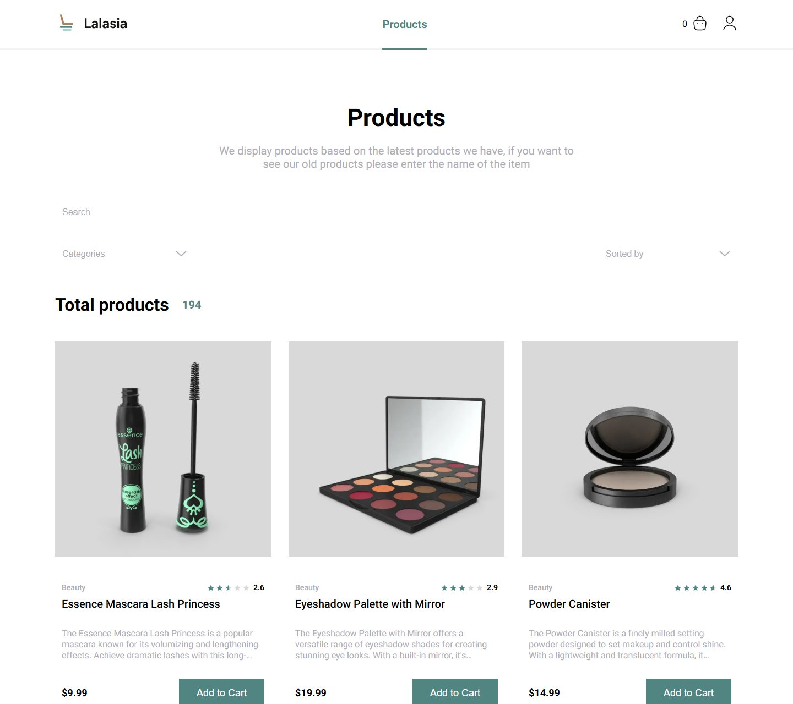
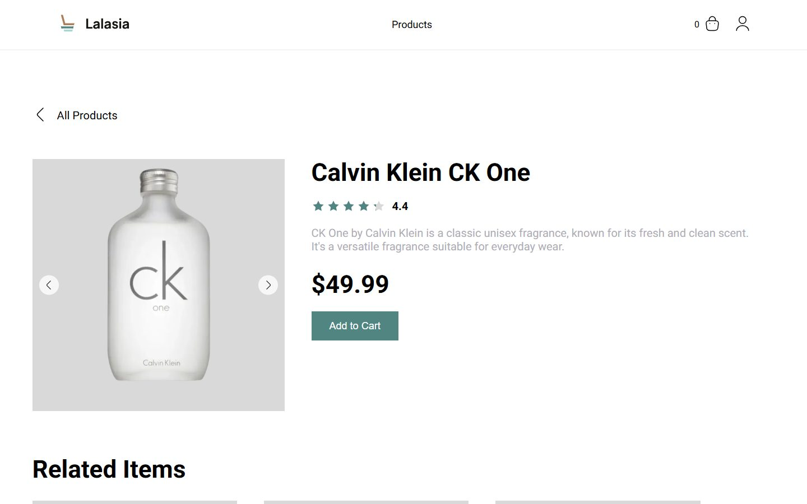
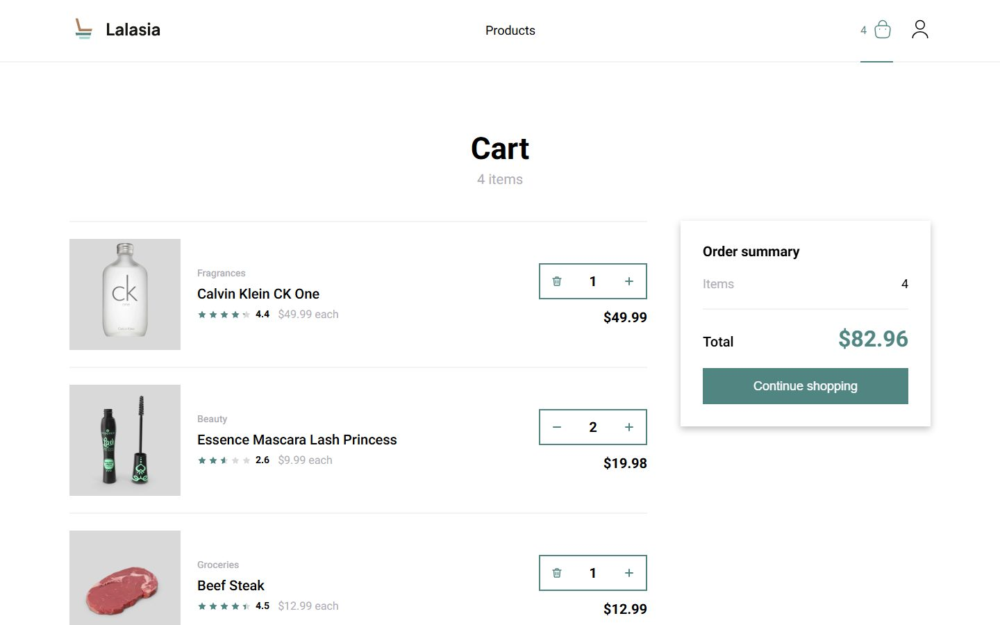
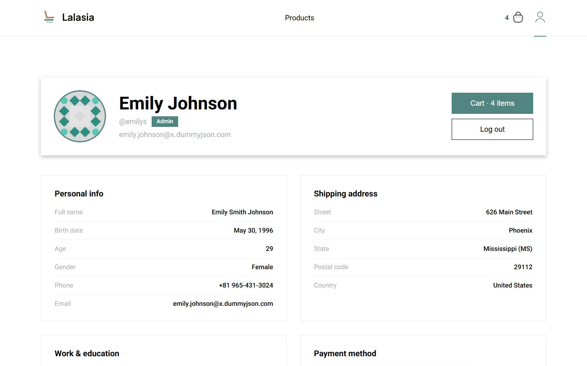
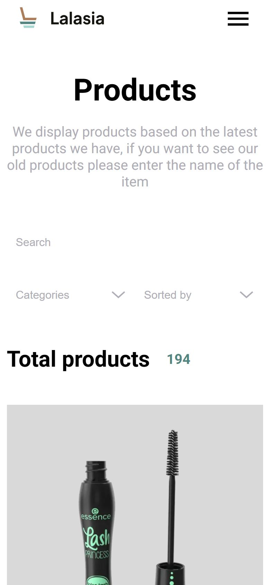

# Lalasia — интернет-магазин

Lalasia — интернет-магазин на Next.js. В нём есть каталог с поиском, фильтрами и сортировкой, карточка товара, корзина, авторизация и личный кабинет. Все данные берутся из публичного API [DummyJSON](https://dummyjson.com).

Проект сделан в рамках школы KTS. Изначально он работал с бэкендом на Strapi, потом переехал на DummyJSON.

**Демо:** https://kts-nextjs.vercel.app/



<details>
<summary>Ещё скриншоты</summary>

| Карточка товара | Корзина |
| --- | --- |
|  |  |

| Личный кабинет | Мобильная версия |
| --- | --- |
|  |  |

</details>

## Тестовый аккаунт

| Логин | Пароль |
| --- | --- |
| `emilys` | `emilyspass` |

Регистрации нет: DummyJSON не умеет создавать пользователей. Для входа подойдёт любой пользователь из [`/users`](https://dummyjson.com/users) с его паролем.

## Стек

- **Next.js 16** (App Router, Turbopack, route handlers)
- **React 19**
- **TypeScript**
- **MobX** + `mobx-react-lite`
- **SCSS-модули**
- **DummyJSON** — источник данных

## Возможности

- **Каталог**:
  - поиск с задержкой (debounce);
  - фильтр по нескольким категориям;
  - сортировка по цене, рейтингу и названию;
  - пагинация с первой и последней страницей.

  Все параметры хранятся в URL, поэтому ссылкой можно поделиться, и она откроется в том же виде.
- **Карточка товара** — слайдер фото, рейтинг звёздами, похожие товары, скелетон на время загрузки.
- **Корзина**:
  - у каждого пользователя своя корзина;
  - количество меняется кнопками − / +;
  - итоговая сумма считается сразу;
  - корзина сохраняется между сессиями.
- **Авторизация** — вход через DummyJSON. Токен хранится в httpOnly-cookie, поэтому JS в браузере его не видит.
- **Личный кабинет** — профиль, адрес, место работы и банковская карта (номер скрыт, видны только 4 последние цифры).
- **Адаптивная вёрстка** — десктоп, планшет и телефон.
- **Оптимизация картинок** — `next/image` с `sizes`, картинки начинают грузиться заранее, ещё до того, как карточка появится на экране.
- **Доступность** — пагинацией можно пользоваться с клавиатуры, для скринридеров заданы `aria-*` атрибуты и нормальные `alt` у картинок.
- **Страницы ошибок** — свои страницы 404 и «что-то пошло не так». Если API недоступно, сайт не падает целиком, а показывает понятное сообщение.

## Архитектура

```
src/
├── api/        адаптер DummyJSON и серверные хелперы
├── app/        страницы (App Router) и route handlers в app/api
└── shared/     компоненты, MobX-сторы, типы, стили, утилиты
```

**Адаптер API** — папка `src/api/`. Компоненты не знают о формате DummyJSON. Функции адаптера превращают ответы API во внутренние типы (`Product`, `ProductCategory`, `ProductCart`):

- `toProduct` собирает товар;
- `formatCategoryName` превращает slug категории в нормальное название;
- сортировка `price:asc` разбивается на `sortBy` и `order`;
- пагинация строится из `limit` / `skip`.

DummyJSON не умеет выбирать несколько категорий сразу и искать внутри категории. В этих случаях адаптер загружает товары категорий и сам фильтрует, сортирует и разбивает их на страницы. Если сменить бэкенд, переписывать придётся только эту папку.

**Route handlers как прослойка к API** — папка `src/app/api/`. Всё, что связано с токеном, браузер не делает напрямую, а отправляет в свои route handlers:

- `auth/login` логинится в DummyJSON и кладёт токен в httpOnly-cookie;
- `auth/logout` и `auth/me` выходят из аккаунта и проверяют сессию;
- `cart`, `cart/add`, `cart/remove` работают с корзиной.

DummyJSON не сохраняет корзины, поэтому корзина хранится в cookie `cart_<id пользователя>` на стороне этих хендлеров. Пользователь сессии определяется в `src/api/session.ts`.

**Сторы** — MobX, папка `src/shared/stores/`.

- **Глобальный `RootStore`** содержит `authStore` и `cartStore`. Он создаётся в `providers.tsx` и сразу заполняется данными, которые `layout` получил на сервере. Поэтому корзина и статус входа видны с первой отрисовки, без мигания.
- **Локальные сторы страниц** создаются через `useLocalStore`:
  - каталог: `ProductsPageStore` объединяет `ProductsQueryStore` (синхронизация с URL) и `ProductsStore`;
  - категории: `CategoriesStore`;
  - страница товара: `ProductStore`.

**Рендеринг.** Каталог, страница товара и личный кабинет получают данные на сервере. Клиент заполняет сторы готовыми данными и дальше обновляет их при навигации.

## Запуск проекта

Нужен Node.js 20.9 или новее и Yarn.

Создайте `.env.local` в корне проекта:

```bash
NEXT_PUBLIC_API_URL=https://dummyjson.com
```

Установка зависимостей:

```bash
yarn
```

Запуск в режиме разработки:

```bash
yarn dev
```

Production build:

```bash
yarn build
```

Запуск production-версии:

```bash
yarn start
```

Проверка lint:

```bash
yarn lint
```

## Ссылки

- Prod: https://kts-nextjs.vercel.app/
- Repository: https://github.com/seffax098/kts_nextjs
